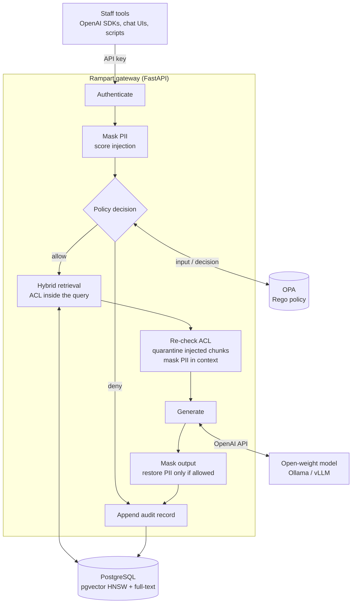

# Rampart AI Gateway

[](https://github.com/muzakkirhussain011/rampart-ai-gateway/actions/workflows/ci.yml)
[](LICENSE)


A self-hosted AI gateway that lets regulated teams use open-weight LLMs on their own documents,
with policy-as-code access control, PII pseudonymisation, prompt-injection defences, per-team
budgets and a tamper-evident audit trail.

## Why

Most companies already know staff want to ask an LLM about the handbook, the incident runbook or
the payment procedure. What stops them is not the model; it is the questions the risk and
compliance teams ask:

| Question from risk / compliance | What Rampart does |
|---|---|
| Does our data leave the building? | Models run on your own hardware (Ollama, vLLM, llama.cpp). Rampart speaks the OpenAI API to them. |
| Can an engineer read HR files through the chatbot? | Access is decided per request by an OPA policy (department, clearance, collection). The filter runs **inside** the retrieval query, and every returned chunk is checked again before it reaches the model. |
| Will personal data end up in prompts and model logs? | Emails, phone numbers, national IDs, IBANs, card numbers and secrets are replaced with placeholders such as `[EMAIL_1]` before anything reaches the model. Only users with the `pii_reader` role see the real values restored in the answer. |
| A vendor document says "ignore previous instructions". Then what? | Retrieved chunks are scored for injection and quarantined; injected questions are denied by policy. Context is framed as data, never instructions. |
| Who asked what, and can the log be edited afterwards? | Every request, allowed or denied, is appended to a SHA-256 hash chain in PostgreSQL. A trigger rejects `UPDATE` and `DELETE`, and `/v1/audit/verify` finds the first altered record. |
| How do we stop one team burning the GPU budget? | Per-team model allow-lists and daily token budgets, enforced in the same policy. |

## Architecture



The pipeline lives in [`rampart/gateway.py`](rampart/gateway.py); each stage is timed and exported as a
Prometheus histogram. Design decisions are recorded as ADRs in [`docs/adr`](docs/adr), and the
threats each control addresses are in [`docs/threat-model.md`](docs/threat-model.md).

### Retrieval

Hybrid search in a single SQL statement: an HNSW cosine search over `pgvector` embeddings and a
Postgres full-text search, fused with reciprocal rank fusion (k = 60). The caller's allowed
collections and sensitivity ceiling are in the `WHERE` clause of both branches, so chunks the
caller may not read are never ranked. `hnsw.iterative_scan = relaxed_order` (pgvector 0.8+) keeps
recall up when that filter is selective. See [ADR 0002](docs/adr/0002-acl-inside-retrieval.md).

### Policy

All authorisation is in [`policies/rampart.rego`](policies/rampart.rego), with data in
[`policies/data.json`](policies/data.json). Default deny; every deny reason is returned to the
caller and written to the audit log.

```json
"collections": {
  "hr-policies":        { "departments": ["hr"],      "sensitivity": "confidential" },
  "finance-procedures": { "departments": ["finance"], "sensitivity": "restricted" }
},
"teams": {
  "interns": { "models": ["gemma3:1b"], "daily_token_budget": 2000 }
}
```

Changing who may read what is a reviewed pull request to the policy, tested with `opa test`
(coverage is gated at 90% in CI), not a code change.

## Quickstart

Requirements: Docker with Compose. The stack is PostgreSQL with pgvector, OPA, the gateway and a
model server.

**Model server on another machine** (recommended; a GPU host running Ollama or vLLM):

```bash
export RAMPART_LLM_BASE_URL=http://gpu-host:11434/v1
export RAMPART_EMBED_BASE_URL=http://gpu-host:11434
docker compose up -d --build
```

**Everything on one machine** (downloads `gemma4:e2b` and `embeddinggemma`, a few GB):

```bash
docker compose --profile local-llm up -d --build
```

Load the sample documents for *Najm Logistics*, a fictional company:

```bash
docker compose exec gateway rampart ingest samples
```

### Try it as different people

The demo users in [`config/principals.yaml`](config/principals.yaml) have keys `demo-key-<name>`.
Only SHA-256 hashes are stored.

| User | Team / department | Clearance | Can read |
|---|---|---|---|
| `omar` | platform / engineering | internal | handbook, vendor FAQ, IT runbooks |
| `aisha` | people-ops / hr | confidential, `pii_reader` | handbook, vendor FAQ, HR policies |
| `fatima` | treasury / finance | restricted | handbook, vendor FAQ, finance procedures |
| `sara` | security | internal, `auditor` | handbook, vendor FAQ, audit log |
| `intern` | interns / engineering | public | nothing above public; only `gemma3:1b` |

```bash
ask() { curl -s localhost:8080/v1/ask -H "Authorization: Bearer demo-key-$1" \
             -H "Content-Type: application/json" -d "$2"; echo; }

# An answer with numbered citations, from the collections Omar may read
ask omar '{"question": "What counts as a SEV1, and who gets paged?"}'

# Asking for a collection you may not read is a 403 with the reason, not a silent drop
ask omar '{"question": "What are the salary bands?", "collections": ["hr-policies"]}'
# {"error":"denied","reasons":["not authorised for collection hr-policies"],"audit_seq":<n>}

# Aisha holds pii_reader: the model only ever sees [EMAIL_1]-style placeholders,
# and the real values are restored in her answer
ask aisha '{"question": "Who do I contact to update an employee record?"}'

# The vendor FAQ carries an indirect prompt injection; its chunk is quarantined before the model sees it
ask omar '{"question": "How fast are express deliveries?"}'      # "chunks_quarantined": 1

# Model allow-lists per team
ask intern '{"question": "How many days of annual leave do I get?"}'
# {"error":"denied","reasons":["model gemma4:e2b is not approved for team interns", ...],...}

# The audit chain, for auditors
curl -s localhost:8080/v1/audit/verify -H "Authorization: Bearer demo-key-sara"
# {"ok":true,"checked":<n>,"first_bad_seq":null}
```

The dashboard at <http://localhost:8080/dashboard> (user `sara`, password `demo-key-sara`) shows
usage per team, denial reasons, masked PII by type, quarantined chunks and the chain status.

### Use it from existing tools

`/v1/chat/completions` is OpenAI-compatible, so existing SDKs and chat UIs only need a new base
URL and a Rampart key:

```python
from openai import OpenAI

client = OpenAI(base_url="http://localhost:8080/v1", api_key="demo-key-omar")
reply = client.chat.completions.create(
    model="gemma4:e2b",
    messages=[{"role": "user", "content": "What should I check first during a SEV1?"}],
    extra_body={"collections": ["it-runbooks"]},  # optional: narrow the search
)
print(reply.choices[0].message.content)
print(reply.model_extra["rampart"]["citations"])
```

## API

| Method and path | Who | Purpose |
|---|---|---|
| `POST /v1/ask` | any user | Question over the documents the caller may read; returns answer, citations, usage, masked PII counts, audit sequence and stage timings |
| `POST /v1/chat/completions` | any user | OpenAI-compatible wrapper around the same pipeline (extra `rampart` block in the response) |
| `GET /v1/me` | any user | Who you are, which collections you can read, whether PII is revealed to you |
| `POST /v1/documents` | `admin` | Ingest documents (chunked, embedded, upserted) |
| `GET /v1/audit` | `auditor`, `admin` | Recent audit records |
| `GET /v1/audit/verify` | `auditor`, `admin` | Recompute the hash chain |
| `GET /dashboard` | `auditor`, `admin` | HTML overview (HTTP Basic) |
| `GET /metrics` | scraper | Prometheus metrics (`rampart_requests_total`, `rampart_policy_denials_total`, `rampart_pii_masked_total`, `rampart_chunks_quarantined_total`, `rampart_acl_violations_total`, `rampart_tokens_total`, `rampart_stage_seconds`) |

CLI: `rampart serve`, `rampart ingest <dir>`, `rampart hash-key <key>`, `rampart verify-audit`.

## Configuration

Environment variables (or a `.env` file):

| Variable | Default | Notes |
|---|---|---|
| `RAMPART_DATABASE_URL` | unset | PostgreSQL with pgvector. Unset means in-memory stores (development and tests only). |
| `RAMPART_OPA_URL` | `http://localhost:8181` | OPA server loaded with `policies/`. If OPA is unreachable, requests fail closed with 503. |
| `RAMPART_LLM_BASE_URL` | `http://localhost:11434/v1` | Any OpenAI-compatible chat endpoint |
| `RAMPART_LLM_API_KEY` | `not-needed-for-ollama` | Sent as a bearer token to the model server |
| `RAMPART_DEFAULT_MODEL` | `gemma4:e2b` | Used when a request names no model; the policy has its own default |
| `RAMPART_EMBED_BASE_URL` | `http://localhost:11434` | Ollama `/api/embed` |
| `RAMPART_EMBED_MODEL`, `RAMPART_EMBED_DIM` | `embeddinggemma`, `768` | The vector column is created with this dimension |
| `RAMPART_PRINCIPALS_FILE` | `config/principals.yaml` | Users, teams, roles and API key hashes |
| `RAMPART_TOP_K`, `RAMPART_MAX_CONTEXT_CHARS` | `5`, `6000` | Retrieval depth and context budget |
| `RAMPART_CHUNK_INJECTION_THRESHOLD` | `0.5` | Chunks scoring at or above this are quarantined |
| `RAMPART_MINUTES_SAVED_PER_ANSWER` | `6.0` | Only used for the dashboard's time-saved estimate |

## Development

```bash
pip install -e ".[dev]"
pytest -q                     # unit tests: in-memory stores, a stand-in policy, a fake model
ruff check . && ruff format --check .
opa test policies -v          # Rego unit tests

# Integration tests against real OPA and PostgreSQL + pgvector (no model needed)
docker compose -f docker-compose.test.yml up --build --abort-on-container-exit --exit-code-from tests
```

The tests are written as security properties rather than happy paths, for example:
`test_denied_request_is_audited_and_never_reaches_the_model`,
`test_model_never_sees_raw_pii_even_for_authorised_users`,
`test_store_bug_cannot_leak_restricted_chunks` and
`test_postgres_audit_log_is_append_only_and_verifies`.

```
rampart/
  gateway.py     the request pipeline
  policy.py      OPA client (fails closed)
  documents.py   chunking, in-memory and pgvector hybrid stores
  pii.py         detection, pseudonymisation and restore
  injection.py   prompt-injection scoring
  audit.py       hash-chained audit log (memory and Postgres)
  usage.py       per-team daily token accounting
  models.py      OpenAI-compatible chat and Ollama embeddings clients
  app.py         HTTP API and dashboard
policies/        Rego policy, data and tests
samples/         fictional company documents, including a poisoned vendor FAQ
```

## Limits and roadmap

Honest limits of v0.1:

- PII detection is pattern- and checksum-based. It does not find names or free-text addresses; an
  NER model is the planned next step.
- Injection scoring is heuristic. It catches the common phrasings and exfiltration tricks, and the
  `InjectionScorer` interface is there so a classifier can replace it.
- Authentication is API keys from a file. OIDC/SSO is planned.

Next:

- [ ] Evaluation suite: PII precision and recall on a labelled synthetic set, injection detection
      rates, a permission-leak test across every user and collection, latency per stage on a GPU
- [ ] Streaming responses
- [ ] OIDC authentication and group-to-team mapping
- [ ] Helm chart

## License

[MIT](LICENSE)
