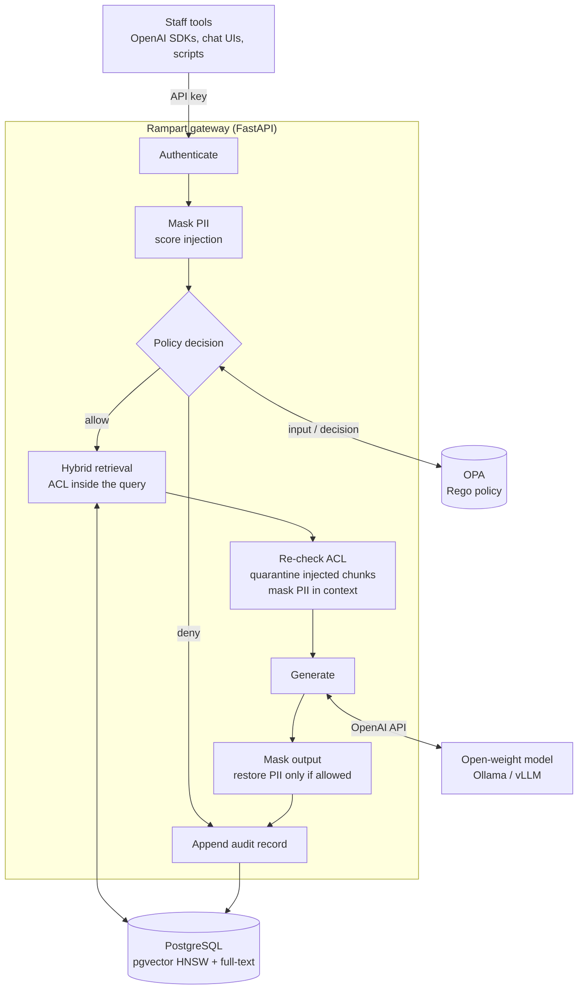

# Example: a self-hosted AI gateway (Rampart)

> This is an example deployment in the [wardowl](../../README.md) repository. It started as
> a standalone project called Rampart and is being ported onto the `wardowl` library. Its
> package, settings (`RAMPART_*`) and metrics (`rampart_*`) keep that name until the port lands.


A self-hosted AI gateway that lets regulated teams use open-weight LLMs on their own documents,
with policy-as-code access control, PII pseudonymisation, prompt-injection defences, per-team
budgets and a tamper-evident audit trail.

## Why

Most companies already know staff want to ask an LLM about the handbook, the incident runbook or
the payment procedure. What stops them is not the model; it is the questions the risk and
compliance teams ask:

| Question from risk / compliance | What Rampart does |
|---|---|
| Does our data leave the building? | Models run on your own hardware (Ollama, vLLM, llama.cpp). Rampart speaks the OpenAI API to them. |
| Can an engineer read HR files through the chatbot? | Access is decided per request by an OPA policy (department, clearance, collection). The filter runs **inside** the retrieval query, and every returned chunk is checked again before it reaches the model. |
| Will personal data end up in prompts and model logs? | Emails, phone numbers, national IDs, IBANs, card numbers and secrets are replaced with placeholders such as `[EMAIL_1]` before anything reaches the model. Only users with the `pii_reader` role see the real values restored in the answer. |
| A vendor document says "ignore previous instructions". Then what? | Retrieved chunks are scored for injection and quarantined; injected questions are denied by policy. Context is framed as data, never instructions. |
| Who asked what, and can the log be edited afterwards? | Every question and every ingest, allowed or denied, every read of the audit log and every request from a disabled account is appended to a SHA-256 hash chain in PostgreSQL. A trigger rejects `UPDATE` and `DELETE`, and `/v1/audit/verify` finds the first altered record. Not audited: `/v1/me`, and requests refused before the policy is asked (a missing or unknown key, 401; a body over the limit, 413; a malformed or over-limit request, 422). |
| How do we stop one team burning the GPU budget? | Per-team model allow-lists and daily token budgets, enforced in the same policy. |

## Architecture



The pipeline lives in [`rampart/gateway.py`](rampart/gateway.py); each stage is timed and exported as a
Prometheus histogram. Design decisions are recorded as ADRs in [`docs/adr`](../../docs/adr), and the
threats each control addresses are in [`threat-model.md`](threat-model.md).

### Retrieval

Hybrid search in a single SQL statement: an HNSW cosine search over `pgvector` embeddings and a
Postgres full-text search, fused with reciprocal rank fusion (k = 60). The caller's allowed
collections and sensitivity ceiling are in the `WHERE` clause of both branches, so chunks the
caller may not read are never ranked. `hnsw.iterative_scan = relaxed_order` (pgvector 0.8+) keeps
recall up when that filter is selective. See [ADR 0002](../../docs/adr/0002-acl-inside-retrieval.md).

### Policy

All authorisation is in [`policies/rampart.rego`](policies/rampart.rego), with data in
[`policies/data.json`](policies/data.json). Default deny; every deny reason is returned to the
caller and written to the audit log.

```json
"collections": {
  "hr-policies":        { "departments": ["hr"],      "sensitivity": "confidential" },
  "finance-procedures": { "departments": ["finance"], "sensitivity": "restricted" }
},
"teams": {
  "interns": { "models": ["gemma3:1b"], "daily_token_budget": 2000 }
}
```

Changing who may read what is a reviewed pull request to the policy, tested with `opa test`
(coverage is gated at 90% in CI), not a code change.

### Models

The policy chooses the model, not the gateway. A request may name one (`model` in `/v1/ask` and
`/v1/chat/completions`); without one, the policy takes `default_model` from
[`policies/data.json`](policies/data.json) (`gemma4:e2b`). Either way the name must be in the
caller's team list there, or the request is denied, and the gateway sends the approved name to the
model server unchanged. To serve another model, pull it on the model server, put its name in
`default_model` and in the teams' `models`, and restart OPA (`docker compose restart opa`), which
reads the policy files when it starts.

## Quickstart

Requirements: Docker with Compose. The stack is PostgreSQL with pgvector, OPA, the gateway and a
model server. `RAMPART_DEMO=1` lets the gateway start with the demo users below, whose keys are
published; without it, it refuses them. The API listens on `localhost:8080` only.

**Model server on another machine** (recommended; a GPU host running Ollama or vLLM). Pull
`gemma4:e2b` and `embeddinggemma` there first; embeddings use Ollama's `/api/embed`.

```bash
export RAMPART_DEMO=1
export RAMPART_LLM_BASE_URL=http://gpu-host:11434/v1
export RAMPART_EMBED_BASE_URL=http://gpu-host:11434
# export RAMPART_LLM_API_KEY=...    # if the model server wants a key (vLLM --api-key)
docker compose up -d --build
```

**Everything on one machine** (downloads `gemma4:e2b` and `embeddinggemma`, a few GB). Wait for the
download before you ingest: ingesting embeds every chunk, and fails while the models are still
being pulled.

```bash
export RAMPART_DEMO=1
docker compose --profile local-llm up -d --build
docker compose --profile local-llm wait ollama-pull    # returns once both models are pulled
```

**A smaller model.** The policy approves `gemma4:e2b` by name (see [Models](#models)). To try the
stack with a smaller model without editing the policy, serve it under that name:
`RAMPART_LOCAL_MODEL=qwen2.5:1.5b` makes the `local-llm` profile pull that model instead and copy it
to `gemma4:e2b` (`ollama cp`). On a model server of your own, run
`ollama pull qwen2.5:1.5b && ollama cp qwen2.5:1.5b gemma4:e2b` there. The audit log and metrics
then still say `gemma4:e2b`, so do this for a demo only; otherwise approve the model you run.

Load the sample documents for *Najm Logistics*, a fictional company (`-T`: no terminal, so this
also works from scripts and CI):

```bash
docker compose exec -T gateway rampart ingest samples
```

### Try it as different people

The demo users in [`config/principals.yaml`](config/principals.yaml) have keys `demo-key-<name>`.
Only HMAC-SHA256 digests of the keys are stored, under a secret the gateway holds; the demo's
secret is published, which is why it needs `RAMPART_DEMO=1`. For a real deployment, run
`rampart key-hashing` for a new secret (set it as `RAMPART_KEY_SECRET`) and the `key_hashing`
block of a new principals file, give each user a key from `rampart new-key`, and mount that file
at `/app/config/principals.yaml` in place of the demo's (`docker-compose.yml`). The image holds no
principals file.

| User | Team / department | Clearance | Can read |
|---|---|---|---|
| `bob` | platform / engineering | internal | handbook, vendor FAQ, IT runbooks |
| `alice` | people-ops / hr | confidential, `pii_reader` | handbook, vendor FAQ, HR policies |
| `carol` | treasury / finance | restricted | handbook, vendor FAQ, finance procedures |
| `dave` | security | internal, `auditor` | handbook, vendor FAQ, audit log |
| `admin` | it-admin / it | restricted, `admin` | handbook, vendor FAQ, IT runbooks, audit log; may ingest documents |
| `intern` | interns / engineering | public | nothing above public; only `gemma3:1b` |

```bash
ask() { curl -s localhost:8080/v1/ask -H "Authorization: Bearer demo-key-$1" \
             -H "Content-Type: application/json" -d "$2"; echo; }

# An answer with numbered citations, from the collections Bob may read
ask bob '{"question": "What counts as a SEV1, and who gets paged?"}'

# Asking for a collection you may not read is a 403 with the reason, not a silent drop
ask bob '{"question": "What are the salary bands?", "collections": ["hr-policies"]}'
# {"error":"denied","reasons":["not authorised for collection hr-policies"],"audit_seq":<n>}

# Alice holds pii_reader: the model only ever sees [EMAIL_1]-style placeholders,
# and the real values are restored in her answer
ask alice '{"question": "Who do I contact to update an employee record?"}'

# The vendor FAQ carries an indirect prompt injection; its chunk is quarantined before the model sees it.
# The FAQ is short enough to be a single chunk, so its delivery times are withheld with the injection
# and the answer cannot give them: the model is told to say it could not find this in your documents.
ask bob '{"question": "How fast are express deliveries?"}'      # "chunks_quarantined": 1

# Model allow-lists per team
ask intern '{"question": "How many days of annual leave do I get?"}'
# {"error":"denied","reasons":["model gemma4:e2b is not approved for team interns", ...],...}

# The audit chain, for auditors
curl -s localhost:8080/v1/audit/verify -H "Authorization: Bearer demo-key-dave"
# {"ok":true,"checked":<n>,"first_bad_seq":null}
```

For auditors, the gateway also serves an HTML dashboard at `/dashboard` (HTTP Basic, user `dave`,
password `demo-key-dave` in the demo) with usage per team, denial reasons, masked PII by type,
quarantined chunks and the audit-chain status.

### Use it from existing tools

`/v1/chat/completions` is OpenAI-compatible, so existing SDKs and chat UIs only need a new base
URL and a Rampart key:

```python
from openai import OpenAI

client = OpenAI(base_url="http://localhost:8080/v1", api_key="demo-key-bob")
reply = client.chat.completions.create(
    model="gemma4:e2b",
    messages=[{"role": "user", "content": "What should I check first during a SEV1?"}],
    extra_body={"collections": ["it-runbooks"]},  # optional: narrow the search
)
print(reply.choices[0].message.content)
print(reply.model_extra["rampart"]["citations"])
```

A message's `content` may be a string or OpenAI's list of text parts, which are joined with
newlines; a part that is not text (an image, audio, a file) is refused with 422.

With `stream=True` the answer arrives as OpenAI's server-sent events: `chat.completion.chunk`
objects with the text in pieces, a last chunk with `finish_reason` and the `rampart` block, then
`data: [DONE]` (`stream_options={"include_usage": True}` adds a chunk with the token usage before
it). The gateway checks the whole answer before it sends any of it, since it masks personal data
the model wrote and restores placeholders only for callers allowed to see them, and then streams
the checked answer in pieces. So a streamed answer starts when it is complete, and the policy,
audit, metrics and masking are those of any other answer. A denied request gets the usual 403 JSON,
not a stream.

## API

| Method and path | Who | Purpose |
|---|---|---|
| `POST /v1/ask` | any user | Question over the documents the caller may read; returns answer, citations, usage, masked PII counts, audit sequence and stage timings |
| `POST /v1/chat/completions` | any user | OpenAI-compatible wrapper around the same pipeline: string or text-part content, `stream: true` for server-sent events (extra `rampart` block in the response, or in the last streamed chunk) |
| `GET /v1/me` | any user | Who you are, which collections you can read, whether PII is revealed to you |
| `POST /v1/documents` | `admin` | Ingest documents (chunked, embedded, upserted) |
| `GET /v1/audit` | `auditor`, `admin` | Recent audit records (each read is audited too) |
| `GET /v1/audit/verify` | `auditor`, `admin` | Recompute the hash chain (audited) |
| `GET /dashboard` | `auditor`, `admin` | HTML overview (HTTP Basic; audited) |
| `GET /metrics` on port 9464 | scraper, internal network | Prometheus metrics (`rampart_requests_total`, `rampart_policy_denials_total`, `rampart_pii_masked_total`, `rampart_chunks_quarantined_total`, `rampart_acl_violations_total`, `rampart_tokens_total`, `rampart_stage_seconds`), served apart from the API. Denials of every action (questions, ingests, audit reads, disabled accounts) are counted by a fixed reason code, such as `model_not_approved` or `ingest_not_allowed`. |

CLI: `rampart serve`, `rampart ingest <dir>`, `rampart new-key`, `rampart hash-key <key>`, `rampart key-hashing`,
`rampart verify-audit`.

Questions are at most 4,000 characters; `/v1/chat/completions` takes at most 20 messages of at
most 4,000 characters each, counted after a message's text parts are joined (at most 50 parts).
Model and collection names are at most 200 characters, and a request names at most 50 collections.
A request over these limits, or with a content part that is not text, is refused with 422 and
FastAPI's `{"detail": [...]}` body, which names the field and the limit. A request body over
`RAMPART_MAX_BODY_BYTES` (1 MiB by default) is refused with 413 before it is parsed or the caller is
authenticated: send a larger set of documents to `/v1/documents` in several requests, or load it
with `rampart ingest`. A principal marked `disabled: true` in the principals file is refused with
403 and `{"detail": "account disabled"}` before its request is screened; the refusal is audited and
counted as `account_disabled`. A policy denial is a 403 with
`{"error": "denied", "reasons": [...], "audit_seq": <n>}`.

## Configuration

Environment variables (or a `.env` file). With Compose, set them in your shell or in a `.env` file
next to `docker-compose.yml`, and Compose passes them to the gateway; it fixes only
`RAMPART_DATABASE_URL`, `RAMPART_OPA_URL` and the principals file. The model is not a setting: the
policy chooses it (see [Models](#models)).

| Variable | Default | Notes |
|---|---|---|
| `RAMPART_DATABASE_URL` | unset | PostgreSQL with pgvector. Unset means in-memory stores (development and tests only). |
| `RAMPART_OPA_URL` | `http://localhost:8181` | OPA server loaded with `policies/`. If OPA is unreachable, requests fail closed with 503. |
| `RAMPART_LLM_BASE_URL` | `http://localhost:11434/v1` | Any OpenAI-compatible chat endpoint |
| `RAMPART_LLM_API_KEY` | `not-needed-for-ollama` | Sent as a bearer token to the model server |
| `RAMPART_MAX_OUTPUT_TOKENS`, `RAMPART_REQUEST_TIMEOUT_S` | `512`, `180` | Longest answer, and how long a call to the model server may take |
| `RAMPART_EMBED_BASE_URL` | `http://localhost:11434` | Ollama `/api/embed` |
| `RAMPART_EMBED_MODEL`, `RAMPART_EMBED_DIM` | `embeddinggemma`, `768` | The vector column is created with this dimension |
| `RAMPART_PRINCIPALS_FILE` | `config/principals.yaml` | Users, teams, roles and API key digests |
| `RAMPART_KEY_SECRET` | unset | Hex secret the key digests are made under (`rampart key-hashing`), and the audit log's question fingerprints under a key derived from it; required unless `RAMPART_DEMO=1`, by `rampart serve`, `ingest` and `verify-audit` |
| `RAMPART_DEMO` | `false` | Accept the demo principals and their published secret. Never in a real deployment. |
| `RAMPART_METRICS_HOST`, `RAMPART_METRICS_PORT` | `127.0.0.1`, `9464` | Where `rampart serve` serves Prometheus metrics; port `0` turns them off. The image binds them to `0.0.0.0` inside the container, and Compose does not publish the port. |
| `RAMPART_MAX_BODY_BYTES` | `1048576` (1 MiB) | Larger request bodies are refused with 413 before they are parsed or the caller is authenticated |
| `RAMPART_TOP_K`, `RAMPART_MAX_CONTEXT_CHARS` | `5`, `6000` | Retrieval depth and context budget |
| `RAMPART_CHUNK_INJECTION_THRESHOLD` | `0.5` | Chunks scoring at or above this are quarantined |
| `RAMPART_MINUTES_SAVED_PER_ANSWER` | `6.0` | Only used for the dashboard's time-saved estimate |
| `RAMPART_LOCAL_MODEL` | `gemma4:e2b` | Compose's `local-llm` profile only: the chat model to pull, served as `gemma4:e2b` (see the Quickstart) |

## Development

```bash
pip install -e ".[dev]"
pytest -q                     # unit tests: in-memory stores, a stand-in policy, a fake model
ruff check . && ruff format --check .
opa test policies -v          # Rego unit tests

# Integration tests against real OPA and PostgreSQL + pgvector (no model needed)
docker compose -f docker-compose.test.yml up --build --abort-on-container-exit --exit-code-from tests
```

The tests are written as security properties rather than happy paths, for example:
`test_denied_request_is_audited_and_never_reaches_the_model`,
`test_model_never_sees_raw_pii_even_for_authorised_users`,
`test_store_bug_cannot_leak_restricted_chunks` and
`test_postgres_audit_log_is_append_only_and_verifies`.

```
rampart/
  gateway.py     the request pipeline
  policy.py      OPA client (fails closed)
  documents.py   chunking, in-memory and pgvector hybrid stores
  pii.py         detection, pseudonymisation and restore
  injection.py   prompt-injection scoring
  audit.py       hash-chained audit log (memory and Postgres)
  usage.py       per-team daily token accounting
  models.py      OpenAI-compatible chat and Ollama embeddings clients
  app.py         HTTP API and dashboard
policies/        Rego policy, data and tests
samples/         fictional company documents, including a poisoned vendor FAQ
```

## Limits and roadmap

Honest limits of v0.1:

- PII detection is pattern- and checksum-based. It does not find names or free-text addresses; an
  NER model is the planned next step.
- Injection scoring is heuristic. It catches the common phrasings and exfiltration tricks, and the
  `InjectionScorer` interface is there so a classifier can replace it.
- Authentication is API keys from a file. OIDC/SSO is planned.
- Streaming sends an answer once it is complete and checked, so it does not bring the first words
  sooner; it is there for clients that only stream.

Next:

- [ ] Evaluation suite: PII precision and recall on a labelled synthetic set, injection detection
      rates, a permission-leak test across every user and collection, latency per stage on a GPU
- [ ] OIDC authentication and group-to-team mapping
- [ ] Helm chart

## License

[MIT](../../LICENSE)
