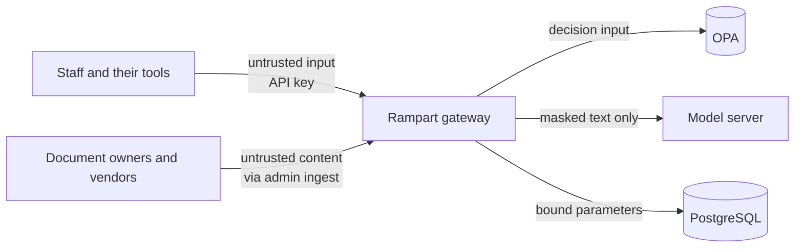

# Threat model

Scope: Rampart v0.1 deployed inside a company network, in front of a self-hosted model server, used by
staff through API keys. The model server, PostgreSQL and OPA are internal services that only the
gateway can reach.

## Assets

| Asset | Why it matters |
|---|---|
| Restricted and confidential documents (HR, finance) | Disclosure to the wrong department is a privacy and regulatory incident |
| Personal data inside documents and questions | Must not reach the model, model logs or unauthorised readers |
| The audit trail | Evidence of who asked what; worthless if it can be edited silently |
| GPU capacity and token budget | Shared and finite |
| The policy | Defines all of the above; a wrong change is a silent breach |

## Trust boundaries

Everything that arrives from users, from documents and from the model is treated as untrusted
text. The model has no tools and no network path through Rampart; its only output is an answer that
is masked again before it is returned.

## Threats, controls and residual risk

| # | Threat | Controls in v0.1 | Verified by | Residual risk |
|---|---|---|---|---|
| T1 | A user reads another department's documents through the assistant | OPA decides readable collections from department and clearance; the filter is in the `WHERE` clause of both retrieval branches; the gateway re-checks every chunk and counts violations (`rampart_acl_violations_total`); asking for a forbidden collection is an explicit deny | `test_engineer_context_contains_no_hr_or_finance_text`, `test_store_bug_cannot_leak_restricted_chunks`, `test_pgvector_hybrid_search_respects_acl`, Rego tests | A document ingested into the wrong collection or with the wrong sensitivity is served as labelled. Ingest is admin-only and audited. |
| T2 | Personal data reaches the model, the model's logs or an unauthorised reader | Questions, history and retrieved chunks are pseudonymised before the model call; the model output is masked again; real values are restored only when the policy grants `reveal_pii`; the audit log stores the masked question | `test_model_never_sees_raw_pii_even_for_authorised_users`, `test_pii_stays_masked_for_users_without_the_role`, PII unit tests | Detection is pattern and checksum based: names and free-text addresses are not detected. Document text is sent unmasked to the embedding model at ingest (self-hosted, but still a copy). The audit record keeps a 16-hex-character unsalted SHA-256 of the raw question, which could be brute-forced when the only unknown is a low-entropy value such as an ID number. |
| T3 | Direct prompt injection in the question (override instructions, exfiltrate secrets, jailbreak) | Heuristic scoring of the question; the policy denies at a score of 0.8 or more; the system prompt pins the model to the numbered context | `test_injection_in_the_question_is_blocked`, `test_attacks_score_high`, Rego tests | Novel phrasings can score low. Impact is bounded: the model only sees passages the caller may already read and has no tools. Earlier turns in `/v1/chat/completions` history are masked but not scored. |
| T4 | Indirect prompt injection planted in a document (for example a vendor FAQ telling the assistant to request passwords) | Every retrieved chunk is scored; chunks at or above 0.5 are quarantined, counted and recorded in the audit log; context is framed as data in the system prompt; markdown-image exfiltration and "send to this address" patterns are signals | `test_poisoned_vendor_chunk_is_quarantined` | Quarantine drops the whole chunk, so legitimate text next to the injection is lost for that answer. Paraphrased instructions can pass. |
| T5 | Audit history is edited or deleted to hide activity | SHA-256 hash chain over canonical JSON; appends are serialised with a transaction-level advisory lock; a trigger rejects `UPDATE` and `DELETE`; `/v1/audit/verify` and `rampart verify-audit` report the first broken record | `test_editing_history_is_detected`, `test_postgres_audit_log_is_append_only_and_verifies` | A database superuser or table owner can `TRUNCATE`, drop the trigger, or rewrite the whole chain consistently. Mitigations: run the gateway as a role that does not own the table, and anchor the head hash outside the database periodically (planned). |
| T6 | A stolen or guessed API key | Keys are stored as scrypt hashes (n=16384, r=8, one random salt per principals file), so a copy of the file costs one scrypt per guess, and are compared in constant time across all entries; `rampart new-key` issues random 256-bit keys; a principal can be disabled and the policy denies it | `test_missing_key_is_401`, `test_identity.py`, Rego tests | No key expiry or rotation; no per-key rate limit. OIDC is on the roadmap. |
| T7 | One team exhausts GPU capacity or budget | Per-team model allow-lists and daily token budgets in the policy; `max_output_tokens`; questions are capped at 4,000 characters | Rego tests, `test_usage_is_recorded_per_team` | The budget is checked before a request, so the last request of the day can overshoot by one answer. No request-rate limiting yet. |
| T8 | The policy engine is down or returns nothing | The client fails closed: an unreachable OPA is a 503 and an undefined decision is a deny | `OpaPolicyEngine` in `rampart/policy.py`; no dedicated test yet | Availability depends on OPA; run it as a sidecar. A fail-closed test is tracked. |
| T9 | A policy change opens access by mistake | Policy as code with default deny, `opa check --strict`, `opa fmt`, unit tests and a 90% coverage gate in CI; unknown teams and unknown actions are denied | CI `policy` job | Tests only cover the cases someone wrote. Policy changes should require review from the data owner. |
| T10 | SQL or full-text query injection through the question | All values are bound parameters; the `tsquery` is built only from `[a-z0-9]` keywords joined with `|` | `test_pgvector_hybrid_search_respects_acl` | None known. |

## Out of scope for v0.1

- Compromise of the host, the database server or the model server itself.
- Network attackers between internal services (run them on a private network; add mTLS if needed).
- Model-quality failures such as wrong but harmless answers. Citations are returned so users can check.
